<picture>
  <source media="(prefers-color-scheme: dark)" srcset="assets/banner-dark.svg">
  <source media="(prefers-color-scheme: light)" srcset="assets/banner-light.svg">
  
</picture>

<i>AI made code cheap. Understanding the system still isn't.</i>

I cooked professionally for years before I traded the knives for an editor. In 2026 I finished my apprenticeship as an application developer (Informatiker EFZ) with an award for my final grade. Today I'm Application Owner at TESTEX, where I also write the handlers and parsers that connect our lab instruments to LabVantage LIMS.

In summer 2027 I start at a Swiss college of higher education (HF). The long-term goal is AI and machine learning, and I pick up everything useful on the way. Claude is my daily sparring partner for design decisions, research and long technical arguments. I use it to think, not to skip thinking.

##  Featured

### Smart Ticket Helper
Final project (IPA) 2026 · internal at TESTEX, not public

A support agent types a problem in their own words and gets the closest matches from three years of support history, even when the old ticket is in Chinese and the question is in German. The old search only knew exact keywords.

Embeddings and search run entirely on-premise, so in production no ticket data goes to an outside service. The tool retrieves real tickets instead of generating text, which means it can't make anything up. When nothing fits, it says so.

Two things no tutorial prepared me for. The textbook similarity threshold rejected every single correct match, so I calibrated my own on real tickets. And the GPU turned embeddings into NaN, so inference moved to the CPU, where it ran faster anyway.

`Python` `FastAPI` `PostgreSQL` `pgvector` `Ollama`

### [GlyphKit](https://github.com/Lunyxium/glyphkit)
Windows · open source (GPL-3.0)

A floating Unicode palette that never steals focus. Click `∑` and it lands right where you were typing. I built it because Windows makes you dig through the character map for every single symbol. One portable .exe, zero dependencies, Win32 called straight from Python.

`Python` `Win32` `tkinter`

### [HexColorPicker](https://github.com/Lunyxium/HexColorPicker)
Windows · open source (MIT)

A small hex color picker, because I was tired of opening a browser for a color code. Pick by hue, saturation and brightness, copy the hex with or without `#`.

`C#` `WPF` `.NET`

##  Building in private

No public repos yet. Click a project for details.

<b>Claude Code mods</b> · Claude Code, steered from a UI instead of slash commands

 

A HUD above the chat input and a side pane show what every agent is doing, how far the current task has come, where the usage limits stand and what the session would have cost at API prices. One panel switches skills, hooks and agent behavior on for the next prompt, the whole session or globally, without touching a JSON file. An editor for Claude's config files is in progress.

The stock UI components weren't enough, so I wrote a skill on custom buttons, menus, panes and CSS for mods. My agents now use it to build the rest. There's also a radio. And a customizable Claude pet.

Catalog coming to GitHub soon.

<b>EonHeart</b> · a browser MMO whose game logic lives inside the database

 

Built in Godot for the web. The game logic lives inside SpacetimeDB as server modules, and clients subscribe straight to the world state. No separate game server, no hand-written netcode, so the time goes into the game instead of the plumbing.

`Godot` `SpacetimeDB`

<b>Untitled drawing app</b> · drawing with an AI on the same canvas

 

Pin notes to exact spots on any layer, sketch the line you want on a layer of its own, and the AI, connected over MCP, sees exactly what you mean and can mark up the image in return. Made for my own game and 3D art workflow.

<b>Vivarium</b> · any website as its own isolated desktop app

 

Turns any website into a real desktop app with its own isolated session, window, Start Menu shortcut and taskbar entry. Install YouTube twice, once for work and once for yourself, logged into different accounts, and the two never see each other. Private mode forgets everything when the window closes. No account, no telemetry.

Windows · on pause, not abandoned

`Electron` `React` `TypeScript` `Tailwind`

##  Stack

**Favourites** 
   

**AI & data** 
   
  

**Building with** 
    
  

**Worked with** 
    
   

##  Open source

The tools I publish are open source, and I picked Godot for my game for the same reason. I want to build on something nobody can take away. I haven't contributed to other projects yet. That's next. With more and more code written by AI, I think open, readable software matters more, and I want to help keep it around.

##  Currently

<table>
  <tr><td><b>Reading</b></td><td><i>The Phoenix Project</i> &amp; <i>The Mythical Man-Month</i></td></tr>
  <tr><td><b>Building</b></td><td>The Claude Code mod catalog, EonHeart, the drawing app, Vivarium</td></tr>
  <tr><td><b>Learning</b></td><td>SpacetimeDB, Godot</td></tr>
</table>

##  Contact

Based in Zurich. I answer in German or English.
